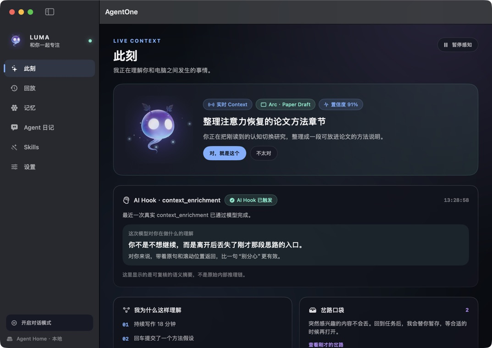
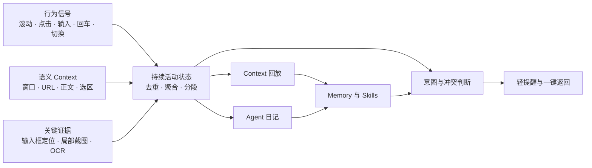
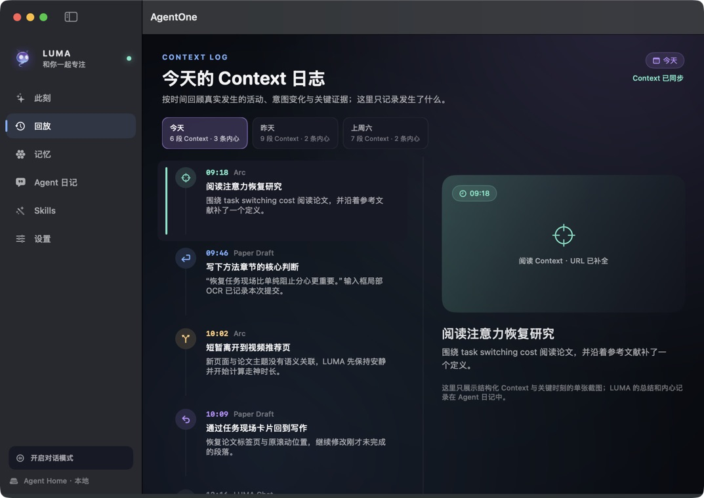
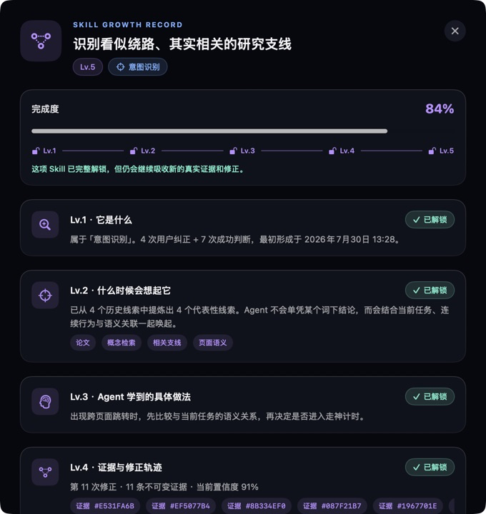

<div align="center">

# AgentOne

[](https://github.com/agentone666-ship-it/AgentOne/actions/workflows/ci.yml)

个人 Context Memory 的 Codex 插件位于 [plugins/personal-context-memory](plugins/personal-context-memory/README.md)。它只读本地日记并提供跨月份、按时间、应用、网站和关键词检索的 `search_context` 工具；产品收敛范围见 [docs/MEMORY_PLUGIN_SCOPE.md](docs/MEMORY_PLUGIN_SCOPE.md)。

### 一个会理解你正在做什么、也会慢慢长成你的样子的 macOS 数字生命

面向 ADHD 与广义容易分心人群的本地优先 Context Agent。

</div>



> [!IMPORTANT]
> AgentOne 目前是可运行的 macOS 原型，而不是可直接分发的成熟产品。它会接触屏幕、Accessibility 与行为信号；请先阅读[隐私边界](docs/PRIVACY.md)，再授予系统权限。

## 为什么做 AgentOne

大多数助手只在用户发出命令后工作。AgentOne 想解决的是另一类问题：当一个人已经走神、忘记原任务，甚至不知道该问什么时，助手能否仍然理解“刚才发生了什么”，用足够轻的方式把人带回来。

它的核心不是统计打开过哪些 App，而是把滚动、点击、输入、回车、应用切换、窗口标题、浏览器 URL、可见正文和关键截图聚合成持续的活动状态，推断用户此刻的真实意图。

LUMA 是 AgentOne 的抽象生命体形象。它不是悬浮的效率按钮，而是朋友与 Jarvis 之间的关系：会观察、会好奇、会保留没说出口的想法，也会因为共同经历而形成记忆和 Skill。

## 已落地的产品闭环



- **持续状态，而不是信号流水账**：连续滚动会形成一段“正在阅读”，不会每滚一下就写一条日记。
- **回车是高价值语义 Hook**：先定位全屏中的输入框，再裁剪输入区域、本地 OCR、保存关键截图，并将提交内容交给模型做静默语义分析。
- **Agent 历史查询工具**：模型可通过 `search_context` 按时间、App、域名、关键词与行为标签查询已记录的 Context；本地筛选后只返回命中结果，详见 [工具接口](docs/CONTEXT_TOOLS.md)。
- **浏览器阅读补全**：读取 URL、标题与页面正文，区分“为了论文查概念”和无关跳转。
- **意图冲突提醒**：默认只有新 Context 与当前任务冲突时才提醒；提醒强度随走神时长递增。
- **任务现场卡片**：记录离开前的窗口、标签页、滚动位置与选中文本，为返回原任务提供入口。
- **双视角记录**：回放回答“我今天具体做了什么”；Agent 日记回答“LUMA 从这些 Context 里理解到了什么”。
- **不可篡改的追加式记忆**：原记录不被覆盖，纠正、隐藏与新理解都作为后续事件追加。
- **自动成长的 Skills**：真实反馈会强化同一个 Skill，按证据、置信度和修正次数逐级解锁详情。
- **主动陪伴**：在合适时机轻提醒、邀请聊天或提出有用的下一步，而不把主动性退化成通知轰炸。

## 界面

### 此刻：让采集、模型和日记链路变得可见


### 回放：按语义片段快速回顾一天



### Skills：共同经历沉淀成可查看、可成长的能力



以上截图由仓库内置的脱敏文档演示模式生成，不包含真实 Agent Home、聊天、工作内容或凭证。

## LUMA：数字生命，而不是工具皮肤

LUMA 的视觉由意识核、记忆轨道和不断变化的粒子轮廓组成：

- 专注时，轨道收束，和用户一起安静工作。
- 好奇时，它靠近 Context，但先问一个中性问题。
- 发现冲突时，提醒从形象变化逐级增加，而不是立刻弹窗打断。
- 用户回到任务时，它会庆祝，但避免抢走注意力。
- 它可以“想而不说”；可展示的是经过整理的工作性思考，不保存或伪装原始模型推理链。

更多产品原则见 [产品愿景](docs/PRODUCT_VISION.md) 与历史 [PRD v0.2](docs/PRD-v0.2.md)。

## 技术架构

AgentOne 由三个明确分工的边界组成：

1. **Swift/macOS 应用层**：全局信号、Accessibility、关键截图、隐私防火墙、状态聚合、意图引擎、日记与全部用户界面。
2. **AgentOneCore**：可测试、与 UI 解耦的 Context、Activity Session、Replay、Memory、Skill 和提醒策略。
3. **Pi Runtime Sidecar**：基于 Pi Agent Core 的受限模型循环，通过 stdin/stdout JSONL 与 Swift 通信，只暴露白名单工具和明确的 token/时间预算。

```text
macOS Hooks / Accessibility / Screen Capture
                    │
                    ▼
       SensitiveContextPolicy
                    │
                    ▼
   Activity Session + Intent + Diary Core
          │                     │
          │                     ├── Replay / Journal / Memory / Skills
          ▼
   Wake Policy + JSONL Bridge
                    │
                    ▼
       Pi Agent Core Sidecar
                    │
                    ▼
  Kimi OAuth / OpenAI-compatible API / Offline
```

完整说明见 [架构文档](docs/ARCHITECTURE.md)。

## 隐私边界

- 不需要 AgentOne 账号，Context 归用户所有。
- Agent Home 由用户选择，日记以 Markdown 与结构化事件保存在本机。
- 密码、验证码、支付与银行 Context 是不可覆盖的禁止采集区，即使用户主动要求也不会开启。
- 聊天正文等内容属于可授权 Context；是否采集由用户设置决定。
- 不录制连续屏幕视频。关键截图由语义 Hook 触发，只保留与当前事件有关的局部证据。
- 用户可以隐藏敏感片段，但不能静默改写历史；纠正会以新的追加事件保留。
- 使用云模型时，只发送通过隐私策略与预算门的 Context。API Key 保存在用户目录下权限为 `0600` 的私密文件中，不进入仓库或 JSONL 消息。

更完整的威胁边界、数据生命周期和发布检查见 [PRIVACY.md](docs/PRIVACY.md)。

## 本地开发

### 环境要求

- macOS 14+
- Xcode/Swift 6.1+
- Node.js 22.19+
- Deno（用于把 TypeScript Sidecar 编译成应用内自包含可执行文件）

### 安装依赖

```bash
cd AgentOneLifeRuntime
npm ci
cd ..
```

### 构建

```bash
swift build
./scripts/build_app.sh release
```

产物位于 `build/AgentOne.app.zip`。项目在 iCloud Drive 中开发时，请先把 ZIP 解压到普通本地目录后再启动，避免 File Provider 元数据破坏代码签名。

### 测试

```bash
npm ci --prefix AgentOneLifeRuntime
bash scripts/ci.sh all
```

每个 PR 和 main 提交自动执行测试与 Release ZIP 验证；安装包、日志、分支门禁和手动草稿预发布见 [CI/CD 指南](docs/CI_CD.md)。原 `./scripts/test_e2e.sh` 仍可用于接口级回归。

这不是启动冒烟测试，而是 10 阶段接口级发布门禁，覆盖：

- TypeScript 单元测试与真实 JSONL 子进程 E2E
- Swift Context/Memory 生产路径 Harness
- OpenAI-compatible 模型接口 Harness
- Swift ↔ Pi Sidecar 进程边界
- Kimi OAuth 本地接口
- 凭证文件权限
- Release App 打包、签名与内嵌 Sidecar 黑盒测试

详细开发说明见 [DEVELOPMENT.md](docs/DEVELOPMENT.md)。

## 仓库结构

```text
AgentOne/
├── Sources/
│   ├── AgentOneApp/              # macOS UI、采集、模型与 Sidecar 桥接
│   ├── AgentOneCore/             # Context、意图、日记、回放、Memory、Skills
│   ├── AgentOneModelAuth/        # Kimi device OAuth
│   └── AgentOneCredentialStore/  # 本机凭证文件
├── AgentOneLifeRuntime/          # Pi Agent Core TypeScript Sidecar
├── Tests/                        # Swift 单元测试
├── scripts/                      # 构建与接口级 E2E
├── docs/                         # 产品、架构、隐私与截图
└── Package.swift
```

## 当前状态与下一步

已可真实运行：全局行为信号、持续 Activity Session、浏览器 URL、回车输入框 ROI 截图/OCR、模型 Context 分析、回放、Agent 日记、Memory、Skill 成长、聊天、Kimi OAuth 和 OpenAI-compatible API。

仍属于产品与工程探索中的方向：更稳健的跨应用恢复、完全本地模型路由、移动端定位协同、外卖/购物视觉执行、长期主动惊喜策略，以及经过签名和公证的公开发行版本。

## 贡献与安全

- 提交代码前请阅读 [CONTRIBUTING.md](CONTRIBUTING.md)。
- 安全与隐私问题请按 [SECURITY.md](SECURITY.md) 中的方式报告，不要在公开 Issue 中附带真实截图、日记或 API Key。
- 当前仓库尚未授予开源许可证；未经明确许可，请勿复制或再分发项目代码与素材。
