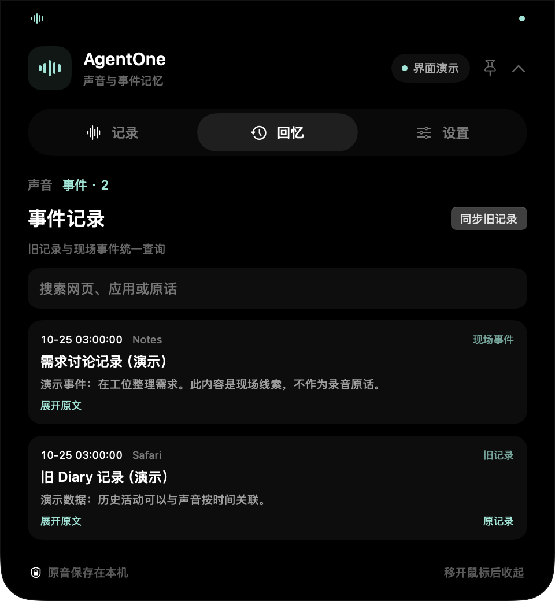
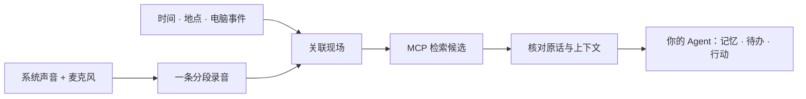

<div align="center">

# AgentOne

**把经历留下，把行动交给你的 Agent。**

macOS 灵动岛 · 自动混合录音 · 事件记录 · 可追溯的个人记忆 · 通用 MCP

[](https://github.com/agentone666-ship-it/AgentOne/actions/workflows/ci.yml)

</div>

> “今天早上在工位和同事聊的那个需求，帮我找出录音，整理成待办，再接着做。”

AgentOne 为这类需求保留现场：电脑声音与麦克风混成一条录音，并关联时间、手动标注的地点和电脑活动。你连接的 Agent 通过 MCP 查找候选、核对原话与上下文，再提取长期记忆或执行你授权的事项。

**现在的界面是屏幕顶部的灵动岛。** 鼠标移到刘海区域展开，移开收起；也可以固定展开。记录、回忆和设置都在岛内完成。

> **开发预览**：新版应用代码与构建入口位于 [`codex/audio-memory-mvp`](https://github.com/agentone666-ship-it/AgentOne/tree/codex/audio-memory-mvp)，见 [PR #2](https://github.com/agentone666-ship-it/AgentOne/pull/2)。本页提前更新产品介绍；`main` 的应用代码仍处于迁移前版本。新版尚未作为正式版本发行。

## 现在的界面

<p align="center">
  
  
</p>

<p align="center">
  
  
</p>

以上图片由当前原生 SwiftUI 界面离屏渲染，使用明确标注的演示数据，不含真实录音、转写或电脑活动。演示中的地点与对话不代表实际记录。

## 它会保留什么

| 信息 | 如何帮助回忆 |
| --- | --- |
| 一条混合录音 | 系统音与麦克风按同一时间轴对齐，分段保存，回放和转写共用一条录音 |
| 时间与现场 | 保留开始时间、时长、输入状态、暂停或断流信息；地点由用户手动标注 |
| 电脑事件 | 关联应用、窗口、可读取的页面与交互线索；旧 Diary 也可检索，细节取决于系统授权 |
| 转写与标签 | 可选本机语音转写；连接的 Agent 领取分析任务，写回主题、事实与待办候选 |
| 长期记忆 | 保存来源引用、有效时间、得知时间与更新替代关系，支持日后重新核查 |

原音和现场线索保存在本机。附近打开的网页只是线索，不能当成谈话原话；提到一个人，也不能直接认定他就是录音中的说话人。

## 从模糊回忆到下一步



1. **自动留下现场**：首次完成系统音和麦克风授权后，自动记录；手动暂停会保留，不会因重启自行取消。
2. **按线索找回来**：Agent 综合主题、时间、地点和事件查找录音；有多个候选时继续核查或向你确认。
3. **核对后再落实**：通过来源与上下文区分提议、承诺和已取消事项，再由宿主 Agent 执行当前授权范围内的任务。

AgentOne 提供采集、检索和记忆接口。持续分析与行动需要你选择的 MCP 宿主运行；接入插件本身不会让已关闭的 Agent 自动工作。

## 运行新版

需要 macOS 15+、Swift 6.1+；MCP 服务需要 Node.js 22.19+。

```bash
git clone https://github.com/agentone666-ship-it/AgentOne.git
cd AgentOne
git switch codex/audio-memory-mvp
swift run AgentOne

# 构建安装包
./scripts/build_app.sh release
```

安装包生成在 `build/AgentOne.app.zip`。在 iCloud 工作区构建时，先解压到普通本地目录，再启动。

- 鼠标悬停刘海约 0.16 秒展开，离开约 0.6 秒收起；图钉可保持展开。无刘海显示器使用顶部胶囊。
- 「记录」页查看输入状态、标注地点、暂停或恢复记录。
- 「回忆」页切换声音与事件，搜索转写、主题或地点，并回放原音。
- 「设置」页管理自动记录、登录启动、锁屏暂停、本机转写和 Agent 原音访问。登录启动以系统实际批准为准。

## 连接你的 Agent

在新版分支中生成通用 MCP 配置：

```bash
node scripts/print_mcp_config.mjs
# 或使用已安装应用中的服务（改为你的实际路径）
node scripts/print_mcp_config.mjs '/Applications/AgentOne.app'
```

把输出加入宿主的 MCP 配置。通过 `recall_context` 查候选，`get_context_bundle` 取原话与上下文，`get_context_event` 核查事件来源。`recall_and_act` prompt 引导宿主完成查找、确认与行动交接。

默认数据目录为 `~/Documents/AgentOne Home/Memory`，也兼容现有 Agent Home 的 `Memory` 子目录；可用 `AGENTONE_MEMORY_HOME` 自定义。

工具与后台分析队列见 [新版 MCP 说明](https://github.com/agentone666-ship-it/AgentOne/blob/codex/audio-memory-mvp/plugins/agentone-memory/README.md)。

## 验证与当前边界

新版分支可运行：

```bash
swift test
swift run AgentOneAudioHarness
node --test plugins/agentone-memory/test.mjs
node benchmarks/recall/run.mjs --check

# 包括迁移期历史回归与安装包检查
npm ci --prefix AgentOneLifeRuntime
bash scripts/ci.sh all
```

CI 检查音频编码与持久化、MCP 子进程、证据校验、任务队列和安装包。模糊回忆固定合成场景通过 **18/18**，探索性语言挑战为 **2/4**；这些结果不代表真实语音识别、多人对话或宿主执行的准确率。详见 [Recall Benchmark](https://github.com/agentone666-ship-it/AgentOne/blob/codex/audio-memory-mvp/benchmarks/recall/README.md)。

已有短时真机混音、本机转写、历史事件导入与原音校验；全天稳定性、真实对话检索效果和宿主完整执行仍需继续验收。目前检索采用词面匹配和宿主查询扩展，尚无向量检索、自动定位或可靠的说话人识别。

## 隐私与开发

不需要 AgentOne 云账号。原音访问需要单独开启；接入宿主后，宿主可能把读取的资料交给云模型。本机文件权限保护不等于应用级加密。使用前请阅读 [新版隐私说明](https://github.com/agentone666-ship-it/AgentOne/blob/codex/audio-memory-mvp/docs/PRIVACY.md)。

新版默认应用由 `AgentOneCaptureApp`、`AgentOneCaptureKit` 与 `plugins/agentone-memory` 组成。旧界面代码仅保留迁移回归，新版分发使用灵动岛与通用 MCP。

[开发与 CI/CD](docs/CI_CD.md) · [新版实现状态](https://github.com/agentone666-ship-it/AgentOne/blob/codex/audio-memory-mvp/docs/vnext/STATUS_CAPTURE_MEMORY.md) · [贡献](CONTRIBUTING.md) · [安全](SECURITY.md)

当前仓库尚未授予开源许可证；未经明确许可，请勿复制或再分发项目代码与素材。
