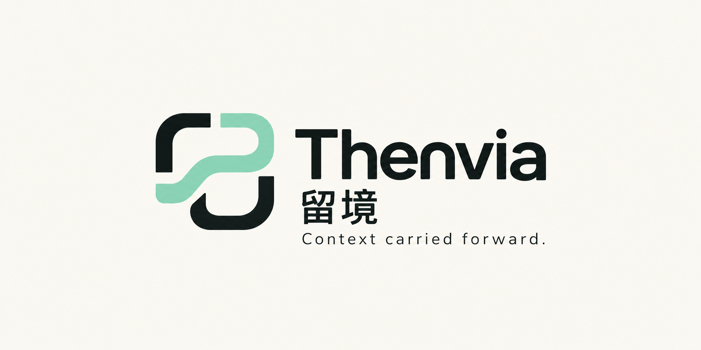
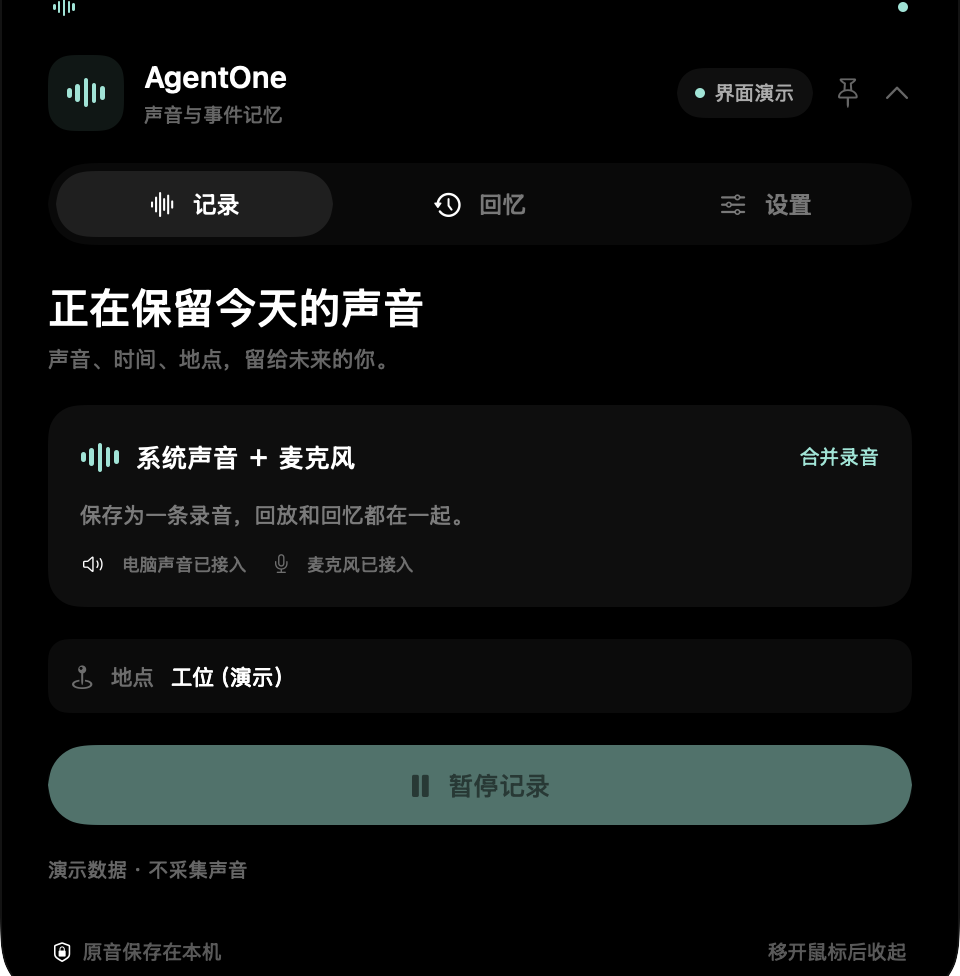
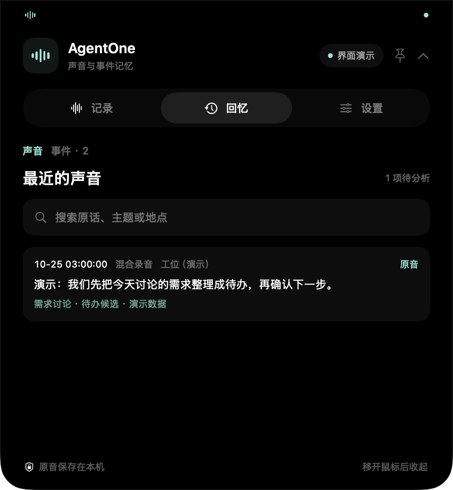

<p align="center">
  
</p>

<div align="center">

**你经历过的，不必再讲一遍。**

给你的 Agent 提供可追溯的个人经历记忆。

[](https://github.com/agentone666-ship-it/Thenvia/actions/workflows/ci.yml)


[体验开发预览](#体验开发预览) · [接入 Agent](#接入你的-agent) · [使用指南](docs/GETTING_STARTED.md) · [English](README.en.md)

</div>

> 「今天早上在工位聊的那个需求，帮我找出录音，整理下一步。」

Thenvia（留境，原 AgentOne）把允许记录的系统声音、麦克风与电脑事件留在本机，让你使用的 Agent 根据时间、地点和内容找回线索，核对原话与上下文，再接着处理。

顶部灵动岛负责记录状态和用户控制，插件与 MCP 负责把资料交给现有 Agent。

> **开发预览**：新版应用目前位于 [`codex/audio-memory-mvp`](https://github.com/agentone666-ship-it/Thenvia/tree/codex/audio-memory-mvp)，见 [PR #2](https://github.com/agentone666-ship-it/Thenvia/pull/2)。`main` 的应用代码仍在迁移前阶段；下面的体验步骤会切换到新版。App 内及配置中的 `AgentOne` 名称暂作兼容保留。

## 留下现场，找回依据，接着做

| 留下现场 | 找回依据 | 接着做 |
| --- | --- | --- |
| 系统音与麦克风混成一条录音，关联时间、电脑事件及获授权的地点线索 | Agent 用模糊线索查找候选，读取原话、前后文和音频来源 | 核对讨论、承诺与后续变更，整理待办或写回长期记忆；宿主负责执行 |

<p align="center">
  
  
</p>

图片由原生界面离屏渲染，使用演示数据，不包含真实录音、位置或工作内容。静态界面展示不代表完整宿主执行已验收。

## 体验开发预览

需要 **macOS 15+、Swift 6.1+**；插件/MCP 服务需要 **Node.js 22.19+**。目前从源码构建，尚无正式发行版。

```bash
git clone --branch codex/audio-memory-mvp https://github.com/agentone666-ship-it/Thenvia.git
cd Thenvia
swift run AgentOne
```

1. 完成首次系统音与麦克风授权，在灵动岛确认输入状态。默认持续保全系统音与麦克风；Laya 只做分段与标签，不阻止原音保存。
2. 在「设置」启用本机转写，在允许记录的环境中说一段测试说明。
3. 等待转写完成，到「回忆 → 整场讨论」搜索关键词，连续回放、看整场原文并确认来源。

0.3.0 起，默认按整场声音会话展示：相邻人声跨一分钟存储边界自动归并，保留三分钟自然停顿；可生成一个连续回放和整场转写。识别和时间归并不等于确认发言者或话题边界。产品保存整场原文与证据；需要总结时交由你正在使用的 Agent 在对话中处理。旧转写可在会话内选择「补全旧版转写」，原音不变、转写按版本保留。

底层约 60 秒封口以便恢复，模型异常仍保存；0.2.11 起，封口后按完整波形复核并自动删除整段接近无声的录音，有声片段中的停顿不裁剪；本机 ASR 后生成带来源的主题预览，低分保留待确认。0.2.10 起“退出灵动岛”会保留后台录音，停止记录请使用暂停按钮。智能触发可选，但可能漏录；手动暂停、锁屏偏好、休眠与断流仍可能留下未保存区间。首次模型配置、构建安装包和故障处理见 [使用指南](docs/GETTING_STARTED.md)，采集修复与验收记录见 [连续录音验证](docs/vnext/CONTINUITY_0210.md)。

## 接入你的 Agent

「设置 → 连接 Agent」提供两种方式：

- **插件**：生成本机插件包，把记忆工具与回忆工作流一起交给支持本地插件的宿主。
- **MCP**：复制配置到支持本机 stdio MCP 的宿主，也可在新版分支运行 `node scripts/print_mcp_config.mjs`。

然后尝试：「查一下刚才那段测试说明，给我原话和录音来源。」

插件导出不包含你的录音库。服务自检与真实宿主连接分别显示；宿主关闭时，接入插件不会让它持续分析。[接入说明](https://github.com/agentone666-ship-it/Thenvia/blob/codex/audio-memory-mvp/plugins/agentone-memory/README.md)

## 资料归你，记录由你控制

- **本机保存**：无需 Thenvia 云账号；原音、索引与记忆保存在本机。
- **随时控制**：暂停/恢复、锁屏暂停、本机转写和原音访问可单独设置。
- **地点有来源**：获授权后使用系统定位；失败时记为未知，不能据此识别具体工位或人物。
- **宿主数据路径明确**：连接的 Agent 可能把读取到的资料交给云模型；原音访问需要单独开启。

录音与事件都应在你有权记录的场景中使用。完整说明见 [隐私与数据控制](https://github.com/agentone666-ship-it/Thenvia/blob/codex/audio-memory-mvp/docs/PRIVACY.md)。

## 当前进展

新版已有持续混合录音、可选声音活动门控、本机主题预览、事件导入、可选本机转写、插件导出与证据回读的实现和局部验证。**全天稳定性、真实对话检索效果，以及具体宿主从找回到执行的完整链路仍在验收。**

检索采用词面匹配和宿主查询扩展；当前不提供可靠说话人识别。长期记忆保留引用与更新关系，附近网页与人物提及需要核对，不能直接当作谈话事实。

[路线图](docs/ROADMAP.md) · [实现与验证记录](https://github.com/agentone666-ship-it/Thenvia/blob/codex/audio-memory-mvp/docs/vnext/STATUS_CAPTURE_MEMORY.md) · [Recall Benchmark](https://github.com/agentone666-ship-it/Thenvia/blob/codex/audio-memory-mvp/benchmarks/recall/README.md)

## 参与

[反馈体验](https://github.com/agentone666-ship-it/Thenvia/issues/new?template=experience.yml) · [报告问题](https://github.com/agentone666-ship-it/Thenvia/issues/new?template=bug_report.yml) · [提出场景](https://github.com/agentone666-ship-it/Thenvia/issues/new?template=feature_request.yml)

请用演示材料或脱敏描述反馈，避免上传私人录音、转写、地点或公司资料。

开发与测试见 [贡献指南](CONTRIBUTING.md) 和 [CI/CD](docs/CI_CD.md)；品牌资源见 [品牌说明](docs/BRAND.md)。

当前源码尚未授予开源许可证。安全问题按 [安全政策](SECURITY.md) 报告。
