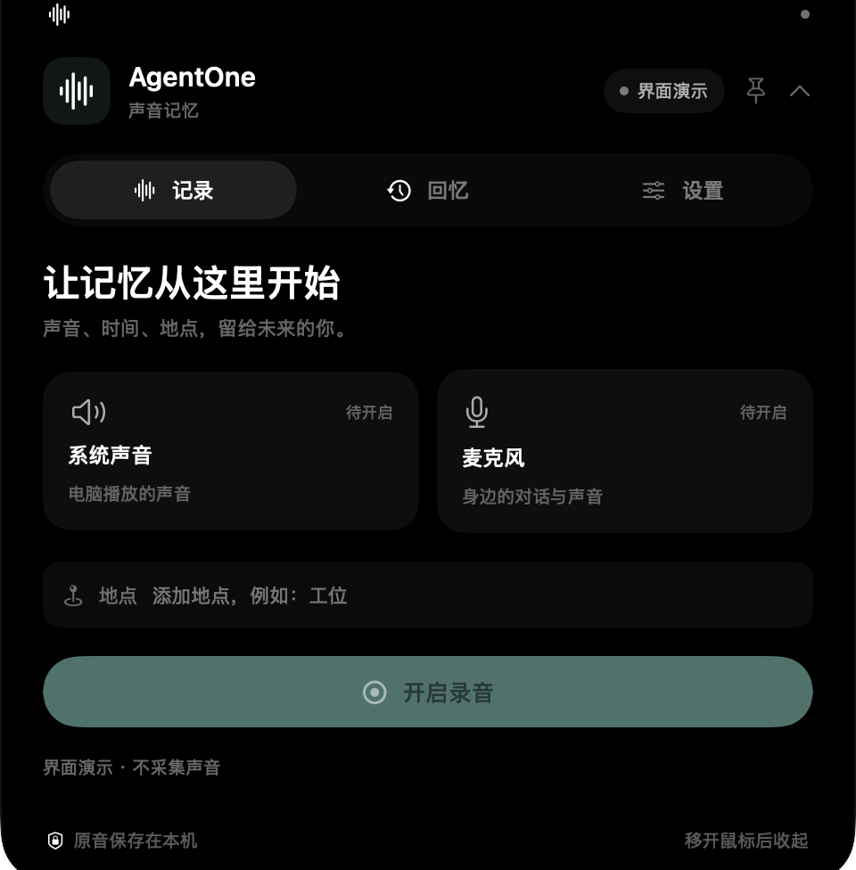

<div align="center">

# AgentOne

[](https://github.com/agentone666-ship-it/AgentOne/actions/workflows/ci.yml)

你的 Agent 的个人经历记忆：原生灵动岛、双路音频与通用 MCP。

</div>

AgentOne v0.2 把电脑上的系统声音和麦克风分别记录在本机，用时间戳关联现场，提供转写、标签、证据与长期记忆的接口。推理和行动交给用户选择的 Agent；默认 App 不再启动或携带 Pi Agent Runtime，也没有独立聊天、模型账号或任务规划器。



> 当前是可运行的开发预览。合成音频、MCP 跨进程、数据持久化和实际 ZIP 已验证；真实设备录音、系统授权、本机 ASR 质量、全天连续性与中文多人对话还需验收。截图来自原生 App 的演示模式，没有真实用户录音。

## 核心链路

```text
系统声音 ── 独立音轨 ──┐
                      ├── 本机分段音频 + SQLite + 时间/地点/应用线索
麦克风 ─── 独立音轨 ──┘                │
                          本机 ASR（显式启用、仅 on-device）
                                      │
                             MCP 待分析队列
                                      │
                         用户的 Agent：标签、事实、待办候选
                                      │
                        带证据的长期记忆 + 更新/替代关系
```

- **原音优先保留**：默认约 60 秒分段，静音不因重要性评分被丢弃；断流、休眠、暂停与异常尾段有状态记录。
- **独立分轨与时间锚点**：保留原始 presentation timestamp、共享 host/wall clock 锚点与时钟映射类型；不把两路声音先混成一个文件。
- **静默处理**：固定的本机 ASR worker 处理转写；宿主 Agent 通过带 lease 的 MCP 队列提取标签。宿主离线时排队，不伪装已经分析。
- **长期记忆可回溯**：宿主可将多段证据巩固为项目摘要、决定、实体线索或未解决事项；保存有效时间、得知时间、引用与替代关系。
- **近期和旧记录一起可查**：关键词变体、日期、来源、地点提示与跨月查询；缺少时间时不只搜最近数据。
- **可控的本机采集**：开始/暂停、可选锁屏暂停、休眠暂停、可选登录续录、手动地点标注、原音回放与最近片段删除。

长期检索当前采用词面匹配和宿主查询扩展，尚未实现 embedding、向量重排、全自动人物识别或跨片段对话合并。原话引用检查不能替代 ASR 与模型质量评估。

## 快速开始

环境：macOS 15+、Swift 6.1+；MCP 需 Node.js 22.19+。新默认 App 的打包不需要 Deno 或 Pi 依赖。

```bash
swift run AgentOne
# 分发 ZIP
./scripts/build_app.sh release
```

产物为 `build/AgentOne.app.zip`。iCloud 工作区中请先解压到普通本地目录，再启动 App。
首次启动不会录音。鼠标移到刘海区域约 0.16 秒自动展开，移开后约 0.6 秒收起；可点击图钉固定。无刘海的显示器使用顶部胶囊。

在「记录」页点击“开启录音”后授予系统音与麦克风权限；本机转写、自动续录与原音访问在「设置」页分别开启。「回忆」页可搜索和回放已有片段。
勾选登录续录后，可在已有授权和用户仍希望录制的前提下恢复；手动暂停不会因重启被悄悄取消。

## 接入任意 MCP 宿主

```bash
node scripts/print_mcp_config.mjs
# 指向安装包中的 MCP 服务
node scripts/print_mcp_config.mjs '/Applications/AgentOne.app'
```

把输出按宿主的 MCP 配置格式接入。服务只提供资料、分析任务与记忆写回，不提供录音启动、shell、发消息或浏览器执行工具。
工具、后台调度和原音访问见 [MCP 说明](plugins/agentone-memory/README.md)。
宿主是否持续运行和如何定时分析，由宿主自己的能力决定；安装 MCP 本身不能让关闭的宿主自动推理。

默认存储在 `~/Documents/AgentOne Home/Memory`，或现有 Agent Home 的 `Memory` 子目录。
通过 `AGENTONE_MEMORY_HOME` 指定 Memory 根目录可用于测试和自定义部署。
旧 Diary 和 [personal-context-memory](plugins/personal-context-memory/README.md) 保留，不会被新版本删除或静默迁移。

## 测试与交付

```bash
# 包含保留的历史回归测试
npm ci --prefix AgentOneLifeRuntime
bash scripts/ci.sh all

# 独立验证新的采集与插件
swift test
swift run AgentOneAudioHarness
node --test plugins/agentone-memory/test.mjs
```

门禁包括实际 CMSampleBuffer → AAC 编码、分段、SQLite、MCP 子进程、引用/任务 lease/删除传播、长期记忆更新，以及最终 ZIP 的签名、资源与无 Pi Runtime 检查。合成转写与标签 fixture 只验证接口，不代表真实模型效果。

[CI/CD 指南](docs/CI_CD.md) · [本次实现状态与验收](docs/vnext/STATUS_CAPTURE_MEMORY.md) · [产品设计](docs/vnext/PRD_ISLAND_AUDIO_MEMORY.md) · [隐私](docs/PRIVACY.md)

## 开发边界

- `Sources/AgentOneCaptureApp`：灵动岛、用户控制与本机生命周期。
- `Sources/AgentOneCaptureKit`：双路采集、音频封口、SQLite、本机 ASR。
- `plugins/agentone-memory`：不绑定宿主的 MCP 与长期记忆数据层。
- `Sources/AgentOneApp`、`AgentOneLifeRuntime`：v0.1 历史实现，仅保留迁移期回归；开发时可显式运行 `swift run AgentOneLegacy`，默认分发不包含它。

没有 AgentOne 云账号。文件权限保护不是应用级加密；接入宿主后，宿主可能把资料交给云模型。请阅读隐私说明再开始日常录音。

当前仓库尚未授予开源许可证；未经明确许可，请勿复制或再分发项目代码与素材。
