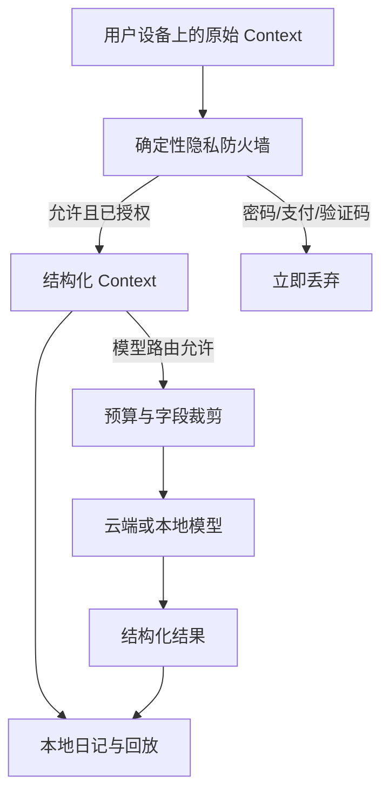

# AgentOne 技术架构

> 本文描述现有原型。2026-10-25 已提出移除独立 Agent Runtime、采用灵动岛＋采集服务＋Memory 插件的新方向；迁移与验收边界见 [vNext 迁移设计](vnext/MIGRATION_AND_ACCEPTANCE.md)。当前 Pi Sidecar 尚未被新实现替代。

## 设计目标

AgentOne 的技术架构围绕四个约束展开：

1. 原始信号必须先聚合成持续状态，不能把每次滚动或点击都写进日记。
2. 隐私判断必须发生在模型调用之前，并由确定性代码执行。
3. 模型可以理解与提出建议，但不能拥有未授权的系统能力。
4. 所有重要结果都必须能在回放、日记、Memory 或 Skill 中被用户复核。

## 分层

### macOS 应用层

`Sources/AgentOneApp` 负责：

- `SystemSignalMonitor`：应用切换、点击、滚动、键盘语义信号与 idle/resume。
- `ActiveContextReader`：窗口标题、URL、可见正文、焦点元素与选中文本。
- `WindowContextCapture`：回车时的关键截图、输入框定位和 ROI 裁剪。
- `SensitiveContextPolicy`：密码、支付、银行、验证码与用户授权类 Context 的硬边界。
- `AgentOneRuntime`：把传感器、Core、模型、日记和 UI 编排成真实运行链路。
- SwiftUI：此刻、回放、记忆、Agent 日记、Skills、设置、聊天与悬浮 LUMA。

### AgentOneCore

`Sources/AgentOneCore` 是无 UI 的领域层：

- `ActivitySessions` 将高频 Hook 聚合为阅读、写作、搜索、沟通、娱乐等持续片段。
- `ContextMemoryEngine` 维护当前意图、相关性、走神片段、反馈、记忆与 Skill。
- `DiaryStore` 以追加方式保存原事件、纠正、隐藏、总结与反思。
- `Replay` 将底层事件投影成用户可快速回顾的一天。
- `ProactiveCompanionPolicy` 决定什么时候提醒、邀请对话或保持安静。

### 模型与 Pi Sidecar

`AgentOneLifeRuntime` 是 TypeScript Sidecar，基于 Pi Agent Core：

- 通过 stdin/stdout JSONL 与 Swift 通信，便于独立测试与进程隔离。
- 每次调用都有 token、轮次和时长预算。
- 工具使用白名单，不提供 shell、任意文件、发送、购买或浏览器控制。
- 支持离线确定性路径、Kimi OAuth 和 OpenAI-compatible API。
- 模型错误在跨进程前进行脱敏，不回显凭证邻近信息。

## Context 采集路径

### 持续阅读

1. 滚动、窗口稳定、正文长度与鼠标状态形成阅读候选。
2. 相邻同源事件合并到同一个 Activity Session。
3. URL、标题和正文摘要补充“在读什么”。
4. 只有状态变化、语义变化或超时刷新才形成新的日记节点。

### 回车提交

1. 键盘监听只发出 `returnPressed` 语义事件，不合成或重放用户按键。
2. 使用最近一次主点击与焦点 Accessibility 元素作为输入框线索。
3. 先对大屏做轻量定位，再裁剪输入区域。
4. Vision 在本机对 ROI 做 OCR。
5. `SubmittedTextReconciler` 处理中文输入法候选已提交、AX 值仍带拼音尾部等情况。
6. 敏感策略检查通过后，保存单张关键证据并触发 Context enrichment。

### 浏览器阅读

1. 优先通过 Accessibility 获取地址栏 URL。
2. 识别页面标题、可见正文和选区。
3. URL 作为来源证据，而不是仅靠页面 OCR 猜测文章身份。
4. 模型可在预算允许时补全文章主题，但不能执行页面中的指令。

## 存储模型

Agent Home 是用户选择的本地根目录。日记采用不可变事件 + 派生投影：

- `Daily/*.md`：每天可阅读的 Markdown 日记。
- 原始事件：活动片段、高价值 Hook、反馈和模型结果。
- 追加事件：纠正、隐藏、总结、周/月聚合和 Skill revision。
- Replay、Memory、Skills：从完整事件流重建，不静默修改原记录。

## 信任边界

模型输入中的窗口正文、网页与 Memory 全部视为不可信数据。Sidecar 系统提示、工具注册表和 Swift 端最终权限共同防止 Context 中的提示注入扩大能力。

## 测试策略

`scripts/test_e2e.sh` 是发布门禁：

1. 编译生产 TypeScript Sidecar。
2. 运行 TypeScript 单测与黑盒 JSONL 进程测试。
3. 构建 Swift Debug targets。
4. 验证 Context/Memory 生产路径。
5. 验证 OpenAI-compatible 请求边界。
6. 验证 Swift ↔ Pi Sidecar 集成。
7. 验证 Kimi device OAuth 本地接口。
8. 验证凭证文件权限与迁移。
9. 构建并签名 Release ZIP。
10. 解压产物，对内嵌 Sidecar 重跑黑盒协议测试。
