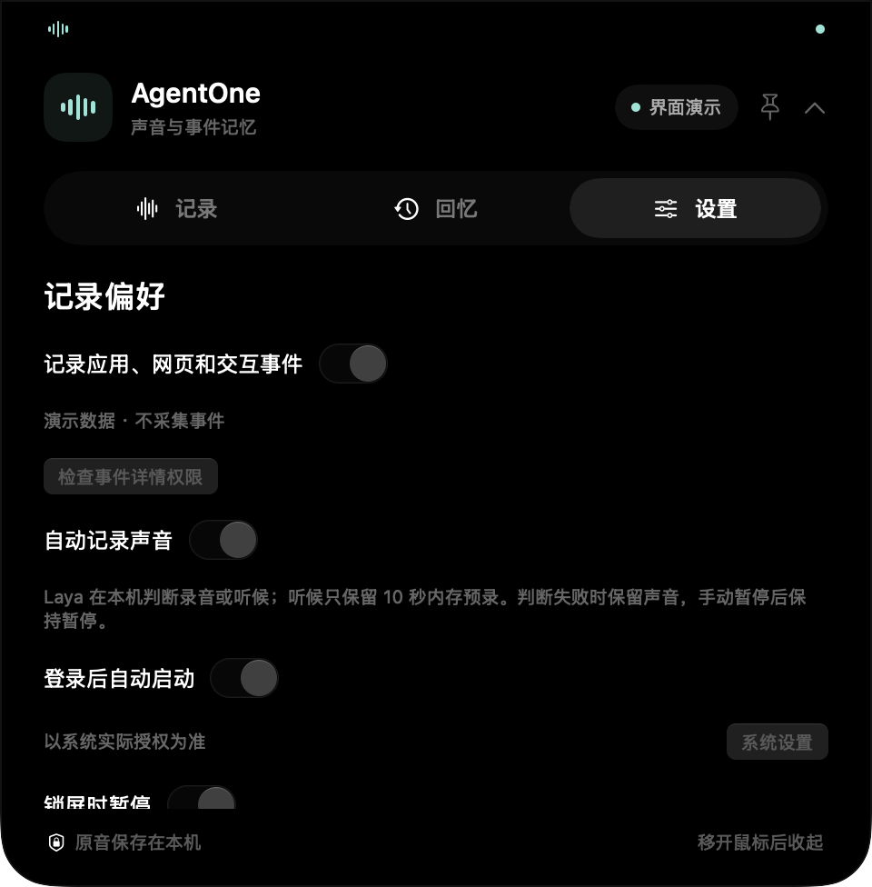

# Thenvia 开发预览使用指南

Thenvia（留境，原 AgentOne）为已有 Agent 保存和检索经历。当前提供源码预览；App、命令与数据标识继续使用 AgentOne，避免影响已有录音和权限。

## 准备

- macOS 15+、Swift 6.1+。
- Node.js 22.19+，用于本机插件/MCP 服务。
- 系统声音与麦克风授权；电脑事件详情、本机语音识别和自动地点分别使用对应系统权限。
- 一个支持本机插件或 stdio MCP 的宿主。首次体验可以先在 App 内搜索，完整的宿主执行链路仍需按宿主验收。

## 安装源码预览

`main` 尚未迁移到新版 App。请显式选择预览分支：

```bash
git clone --branch codex/audio-memory-mvp https://github.com/agentone666-ship-it/Thenvia.git
cd Thenvia
swift run AgentOne
```

鼠标移到顶部刘海区域展开，离开收起；图钉可固定展开。无刘海屏使用顶部胶囊。

如需安装包，在同一分支运行：

```bash
./scripts/build_app.sh release
```

产物为 `build/AgentOne.app.zip`。在 iCloud 工作区构建时，先解压到普通本地目录，再启动。当前安装包是开发预览，正式签名、公证与更新通道另行建设。

## 完成第一次找回

1. 按提示授权系统音与麦克风，检查两个输入是否接入。
2. 在「设置」开启本机转写。准备一段明确允许记录、没有私人资料的测试说明。
3. 0.2.9 默认持续保全；自动记录开启后持续保存混合音频，模型只做分段和标签。默认约 60 秒分段，识别所需时间取决于设备和本机语音资源。
4. 在「回忆 → 声音」搜索测试说明中的关键词，查看转写并回放原音。
5. 对照自己刚说的内容核查；未识别、找错或多个候选都应如实记录。

默认持续保全不依赖模型就绪；模型未知或出错仍保存。0.2.11 起，录音封口后在后台逐窗复核整段波形，只清理整段接近无声的文件；低声内容、含有声音的整段录音及其中停顿保留，无法解码的文件保留待检查。不以“未识别语音”判定静音。可选的智能触发策略可能漏录，只有持续声音与稳定决策满足条件才录音。首次本机 Laya 配置需要 `uv`，并下载依赖与约 650 MB 多语言权重：

```bash
bash scripts/setup_laya.sh
```

配置后重新启动 App，再检查模型与输入状态。持续保全不需要等待模型；智能触发的听候期间只有有限内存预录，不能补回任意长的历史。手动暂停会保留；锁屏、休眠与权限变化可能中断记录。

## 连接 Agent



1. 打开「设置 → 连接 Agent」。
2. 支持本地插件的宿主选择「插件」，生成本机插件包并按导入说明接入；其他支持本机 stdio MCP 的宿主选择「MCP」，复制配置。
3. 「检查服务」只验证服务能否启动；最近宿主连接只有真实握手后才显示。
4. 让宿主查刚才的测试说明，返回原话和音频来源，并与 App 内结果核对。

也可从源码输出配置：

```bash
node scripts/print_mcp_config.mjs
# 如 App 已安装，改成实际路径
node scripts/print_mcp_config.mjs '/Applications/AgentOne.app'
```

导出的插件不包含录音库。宿主是否后台运行、何时领取分析任务，由宿主自己的能力决定。细节见 [插件与 MCP 说明](https://github.com/agentone666-ship-it/Thenvia/blob/codex/audio-memory-mvp/plugins/agentone-memory/README.md)。

## 地点、事件与长期记忆

- 自动地点使用获授权的系统定位，带采样时间和误差；失败时保留未知。系统不能确认具体工位或房间，历史手动标注继续保留。
- 「回忆 → 事件」统一查看旧 Diary 与新的可见活动。详细内容取决于系统权限和隐私规则。
- 原话、桌面事件和模型推断分开核查；某个名字出现，不足以确认发言人。
- 宿主可把来源巩固为长期记忆并保存更新关系；当前检索采用词面匹配和宿主查询扩展，真实长期效果继续评测。

## 数据与常见问题

默认目录为 `~/Documents/AgentOne Home/Memory`，或现有 Agent Home 下的 `Memory`。保留旧标识可以继续使用已有资料。

**为什么没录下来？** 优先确认选择“持续保全”且自动记录开启，再检查输入授权、手动暂停、锁屏、休眠和存储错误；智能触发还需检查持续声音与 Laya 状态。不要把覆盖空白理解为没有发生事情。

**为什么一直等转写？** 检查是否启用本机语音识别、语言资源是否可用；本机不可用时不自动上传云端补识别。

**为什么地点未知？** 检查系统定位总开关和 App 授权，或当前精度/采样是否有效；不使用 IP 或 Wi-Fi 名称猜具体地点。

**为什么插件导出后还没连接？** 需要宿主实际导入并启动。导出、自检、真实握手是不同状态。

**如何反馈？** 提交 [体验反馈](https://github.com/agentone666-ship-it/Thenvia/issues/new?template=experience.yml) 或 [问题报告](https://github.com/agentone666-ship-it/Thenvia/issues/new?template=bug_report.yml)，附版本、状态和脱敏步骤，不上传真实录音库。
